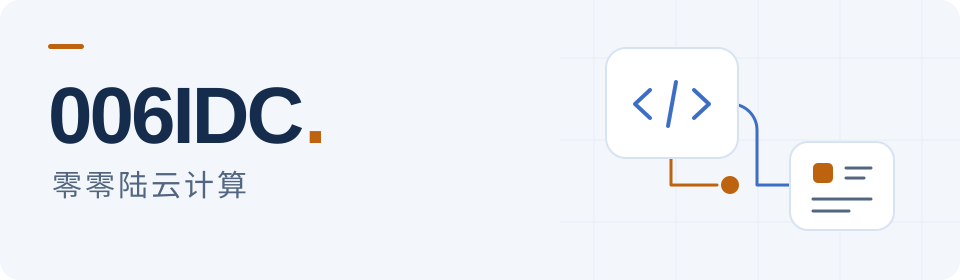

<picture>
  <source media="(prefers-color-scheme: dark)" srcset="assets/profile-hero-dark.svg">
  
</picture>

# 电商 AI 应用与 V10 业务扩展

**006IDC · 零零陆云计算** 围绕商品内容制作与云业务系统，开发和维护实用软件，分享源码、文档与版本更新。

[探索 AI 应用](#ai-商品素材工厂) · [查看 V10 插件](#v10-开源插件) · [全部开源仓库](https://github.com/006IDC?tab=repositories&type=public)

## AI 商品素材工厂

面向电商商家的 AI 商品素材工作台。从商品建档到图片、详情页与视频任务，在同一工作台管理商品内容与素材。

**商品资料 → 图片创作 → 详情页 → 视频任务 → 素材管理**

[进入项目 →](https://github.com/006IDC/ai-commerce-asset-factory) [使用文档](https://github.com/006IDC/ai-commerce-asset-factory/blob/main/docs/repository-guide.md) [版本发布](https://github.com/006IDC/ai-commerce-asset-factory/releases)

## V10 开源插件

为 ZJMF-CBAP V10 提供活动、用户权益、支付与人机验证扩展。

- **[商品拼团](https://github.com/006IDC/v10-group-buy-public)** 
  多人开团、邀请分享与优惠活动。
- **[用户等级与推广权益](https://github.com/006IDC/v10-client-level-public)** 
  消费与推广贡献评定、等级权益及提现衔接。
- **[易支付 V1 网关](https://github.com/006IDC/v10-easypay-gateway-public)** 
  聚合收银台接入、支付通知校验与原生入账。
- **[极验 GT4](https://github.com/006IDC/v10-geetest-gt4-public)** 
  为启用的安全业务场景提供人机验证。

## 使用与反馈

1. **选择项目**：先阅读对应 README，核对适用版本、依赖与部署说明。
2. **获取版本**：在项目 Releases 与更新记录中核对所需版本，按项目说明选用发行包或源码。
3. **交流改进**：通过对应项目的 Issues 反馈问题或提交建议，欢迎贡献 Pull Request。安全问题请先查看对应仓库的反馈说明。

---

独立开源项目 · 许可与第三方权利以各仓库说明为准 · [主页变更记录](CHANGELOG.md)
